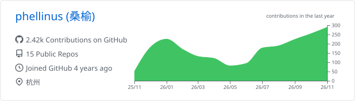
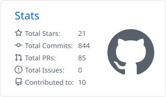
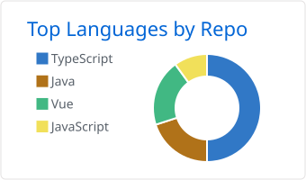
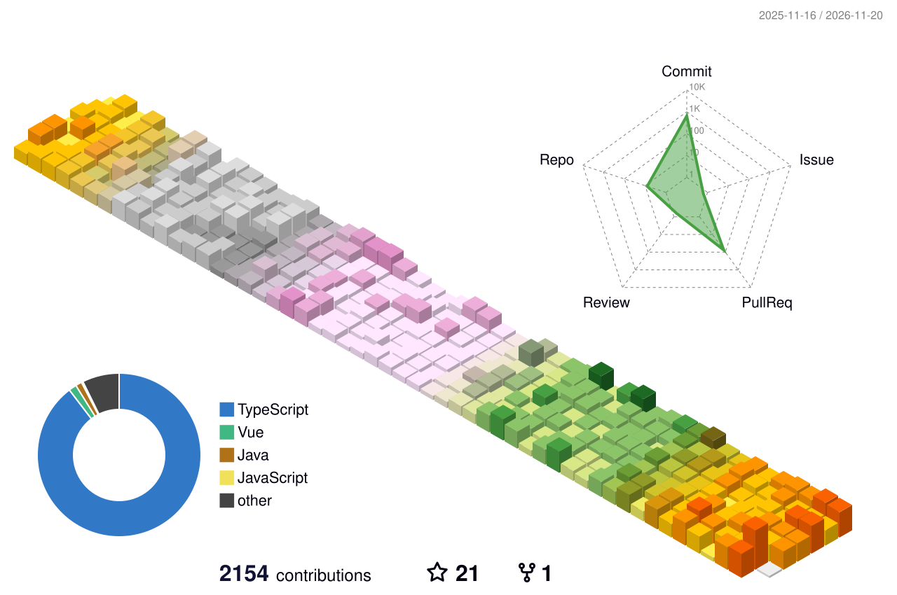

<h1 align="center">Hello, I'm Sangyu 👋</h1>

  <strong>Frontend Engineer · Component Library Builder · Exploring AI Agents</strong>

  
  
  
  
  

## 🧭 About Me

- 🎓 I graduated from Zhejiang University of Science and Technology in 2026 with a degree in computer science and technology. I started my first internship the summer after my junior year and have been learning ever since.
- 💼 I work as a frontend engineer and build personal projects after work.
- 🧩 I open-sourced a Vue component library and continue to improve and maintain it.
- 🧩 I'm also building a React component library and hope to open-source it by the end of the year.
- 🤖 I'm learning how to build LLM applications and AI agents so I can make tools of my own.
- 🚀 My background is in frontend development, and I'd like to get back into writing backend code.
- 💬 I enjoy talking about frontend tooling, monorepos, CI/CD, role-based access control, and JWT authentication.
- 🌿 Outside work, I enjoy football, climbing mountains, hiking, traveling on a budget, and solving Rubik's Cubes.
- 🏡 Someday, I'd love to run a guesthouse somewhere beautiful and write code in my own courtyard.

## 🎯 Current Focus

- Deepening my knowledge of **TypeScript, React, and Vue** through component design and frontend tooling.
- Taking my component libraries from API design through documentation and release.
- Building full-stack skills by using **Electron, Node.js, and Spring Boot** in real projects.
- Learning to build **AI agents** by working with model APIs, tool calling, and workflow orchestration.

## 🛠 Tech Stack

  
  
  
  
  
  
  
  
  
  
  
  

## 🚀 Featured Projects

| Project | Description |
| :--- | :--- |
| **[Sangyu UI](https://vue.sangyulab.top/)** | An open-source Vue component library for building web interfaces. |
| **[Lumen Drift](https://github.com/phellinus/vscode-theme-lumen-drift)** | A color theme for Visual Studio Code. |
| **[React Template](https://github.com/phellinus/react-template)** | A starter template for React projects built with TypeScript and Vite. |

> I'm working on a few more projects and will open-source them when they're ready.

## 📊 GitHub Activity

<!-- These static SVGs are generated daily by .github/workflows/profile-summary-cards.yml. -->

  

  
  

## 📈 Contribution Timeline

<!-- Keep the existing 3D contribution visual generated by your original workflow. -->

## 🐍 Contribution Snake

<picture>
  <source media="(prefers-color-scheme: dark)" srcset="https://raw.githubusercontent.com/phellinus/phellinus/output/github-contribution-grid-snake-dark.svg" />
  <source media="(prefers-color-scheme: light)" srcset="https://raw.githubusercontent.com/phellinus/phellinus/output/github-contribution-grid-snake.svg" />
  
</picture>

---

Thanks for stopping by — happy to connect and build something useful together.

